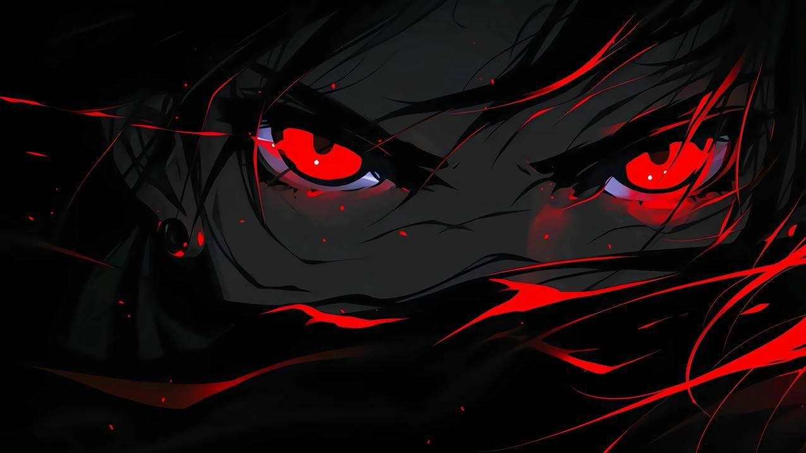

 

# 🩸 TheKingSync

### `WELCOME TO MY PROFILE`

**「 Java, SQL, HTML 」**

---

## 🕷️ Sobre mí

- 👑 **Usuario:** TheKingSync
- 💻 **Intereses:** Programación y tecnología
- ⚡ **Objetivo:** Crear algo que destaque, y subir mis proyectos de clase.

---

## ⚔️ Tecnologías

---

##  Proyectos

**[01] — Mis creaciones**

Proyectos, experimentos y nuevas ideas.

<!-- Puedes añadir tus repositorios destacados aquí -->

---

## 🩸 GitHub Stats

---

### 🩸 「 THE KINGSYNC 」

*No limits. No fear. Just code.*

